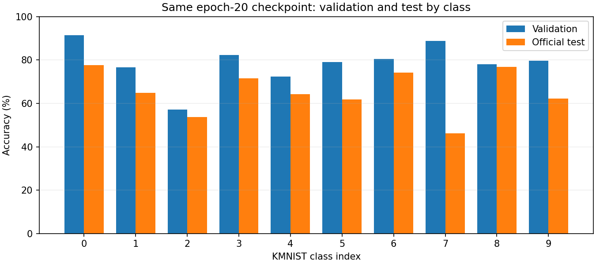

# KMNIST evaluation discrepancy audit

The **13.38 percentage-point gap was reproduced**, not corrected away.
The same saved epoch-20 model gives 78.72% validation and 65.34% test accuracy.
The original GPU evaluator (batch 64), a separate CPU evaluator using
per-example losses (batch 257), and `evaluate.py` (batch 256) agree on accuracy.
Loss differences are below 1e-6. No optimisation is performed during these checks.

- All four official KMNIST archive MD5 checksums match torchvision's resources.
- The 55,000/5,000 training/validation index sets are disjoint and cover the
  60,000 training examples. Test uses the separate official 10,000-example set.
- All 70,000 loaded raw images and labels also match the decoded official
  archives, rather than merely finding valid archives alongside an unchecked
  loaded cache. Labels are in the expected 0–9 range. SHA-256 image comparisons
  found no exact training/validation overlap or official train/test overlap.
- Training/validation and test use the same tensor conversion and [0, 1]
  scaling. Nine raw-pixel/label sample checks passed within float32 tolerance.
- Strict checkpoint loading reproduces the recorded validation and test
  metrics. Evaluation leaves the weights unchanged.
- Reweighting validation class accuracies to the balanced test proportions
  gives **78.60%**, so class proportions alone do not remove the discrepancy.

Full checks and confusion matrices: [evaluation_audit.json](results/evaluation_audit.json).
Class-level numbers: [class_evaluation.csv](results/class_evaluation.csv).
Complete loaded-data verification:
[data_integrity_review.json](results/data_integrity_review.json).
Accuracy is lower on test in every class; the largest observed drop is class 7.
This is a diagnostic observation, not proof of the mechanism causing the gap.

A fresh, unchanged 20-epoch run reproduced every original epoch record,
selected epoch 20, all selected model tensors and the final test metrics
exactly in the same environment. The original `results/metrics.json`, curves
and checkpoint were preserved. The new comparison is a separate artifact:
[reproduction_review.json](results/reproduction_review.json).

**Conclusion:** no fault was found in the audited data, split, checkpoint or
evaluation paths. The discrepancy remains unresolved; these checks do not
establish whether its cause is sample difficulty, within-class distribution
differences, the learned model or another untested factor. No architecture,
optimiser or split was changed, and no test-based tuning was performed.

**Confirmed bugs versus limitations:** no implementation/evaluation bug causing
the gap was confirmed, so the original training/model code was not rewritten.
The added tools improve verification and reuse; they are not a claimed fix for
the accuracy difference. Near-duplicate images and writer/style overlap have
not been assessed. The validation subset comes from the official training pool
and is not guaranteed to represent every property of the official test set.
One seed and one training budget do not establish a causal explanation or
multi-run uncertainty. Re-evaluating this already reported test set is an audit,
not an additional independent generalisation experiment.

Eight dataset-free tests passed during this review, including regression checks
for validation-only checkpoint selection, wrong-dataset checkpoint rejection,
changed loaded-cache detection and reporting exact image overlap.
The additional audit/regression tests were run locally; the published
baseline test suite remains unchanged.
