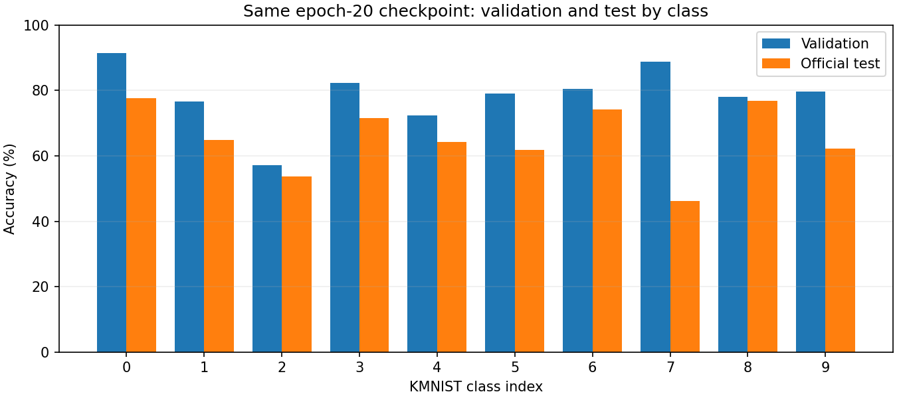

# KMNIST MLP learning exercise

A PyTorch multilayer perceptron for classifying 28 x 28 Kuzushiji-MNIST images.
This exercise demonstrates dataset loading, autograd, optimisation, validation
and held-out evaluation, using Mamadou's existing model and training loop.
See [PROVENANCE.md](PROVENANCE.md) for the source identity and AI-assisted edits.

The original model was implemented by Mamadou from theory learned through
PyTorch documentation, Medium articles and Lilian Weng's writing. Later
AI-assisted engineering changes are documented in [PROVENANCE.md](PROVENANCE.md).

## Method and provenance

The architecture is flatten -> Linear(784, 512) -> ReLU -> Linear(512, 512)
-> ReLU -> Linear(512, 10). Images are converted to floating-point tensors in
[0, 1]. Cross-entropy and SGD with learning rate 0.001 are preserved.

Codex extracted the architecture from the supplied `kminst_mlp.py`, corrected
its naming and moved execution into the trainer. The architecture,
seeded weights and forward outputs were compared against the original class
and match exactly. The original file was left unchanged.

The original uses 60,000 training images and evaluates the test set after every
epoch. This prepared workflow instead holds out 5,000 training examples for
validation (55,000/5,000 split, seed 42), selects the lowest-validation-loss
checkpoint, and evaluates the separate 10,000-image test set once at the end.
Results therefore are not directly comparable with a run of the original file.


## Reproduce

From the **repository root** with Python 3.10+:

```powershell
python -m pip install -r requirements.txt
python train.py --epochs 20 --seed 42
```

CUDA is selected when available; `--device cpu` forces CPU. Data downloads to
`./data`; use `--data-root PATH --no-download` for an existing cache. Outputs
are `outputs/kmnist-seed42/{metrics.json,curves.png,best.pt,last.pt}`. Use a new
`--output-dir PATH` for another run; nonempty directories are rejected.
Checkpoints include model and optimiser state, epoch and seed. Resume is not
automated. Data and weights are excluded from Git.

Evaluate a checkpoint without retraining:

```powershell
python evaluate.py --checkpoint outputs/kmnist-seed42/best.pt --data-root data --no-download
```

This loads the checkpoint strictly, checks its dataset identity, switches to
evaluation mode and reports validation/test metrics without optimisation or
checkpoint selection. The original baseline weights are not hosted; train
locally first. `--output PATH` saves JSON and refuses to overwrite an existing file.

For the recorded seed-42 baseline, run the independent integrity/evaluation audit:

```powershell
python audit_checkpoint.py --checkpoint outputs/kmnist-seed42/best.pt --data-root data --output outputs/kmnist-audit.json
```

The audit checks official cached archive hashes, split coverage, preprocessing,
checkpoint selection and an independent CPU evaluator. It expects the original
download archives to remain in the cache and compares against `results/metrics.json`.

Run dataset-free training tests with:

```powershell
python -B -m unittest discover -s tests -v
```

Dataset information and attribution: https://github.com/rois-codh/kmnist

## Results and limitations

The measured 20-epoch, seed-42 baseline selected epoch 20 by validation loss:

| Metric | Measured result |
|---|---:|
| Validation accuracy at selected epoch | 78.72% |
| Held-out test accuracy (10,000 images) | 65.34% |
| Held-out test cross-entropy | 1.1184 |
| Trainable parameters | 669,706 |

Full history and conditions: [metrics.json](results/metrics.json).


### Evaluation discrepancy audit

The **13.38 percentage-point gap was reproduced**, not corrected away.
The same saved epoch-20 model gives 78.72% validation and 65.34% test accuracy.
The original GPU evaluator (batch 64), a separate CPU evaluator using
per-example losses (batch 257), and `evaluate.py` (batch 256) agree on accuracy.
Loss differences are below 1e-6. No optimisation is performed during these checks.

- All four official KMNIST archive MD5 checksums match torchvision's resources.
- The 55,000/5,000 training/validation index sets are disjoint and cover the
  60,000 training examples. Test uses the separate official 10,000-example set.
- All 70,000 loaded raw images and labels also match the decoded official
  archives, rather than merely finding valid archives alongside an unchecked
  loaded cache. Labels are in the expected 0–9 range. SHA-256 image comparisons
  found no exact training/validation overlap or official train/test overlap.
- Training/validation and test use the same tensor conversion and [0, 1]
  scaling. Nine raw-pixel/label sample checks passed within float32 tolerance.
- Strict checkpoint loading reproduces the recorded validation and test
  metrics. Evaluation leaves the weights unchanged.
- Reweighting validation class accuracies to the balanced test proportions
  gives **78.60%**, so class proportions alone do not remove the discrepancy.



Full checks and confusion matrices: [evaluation_audit.json](results/evaluation_audit.json).
Class-level numbers: [class_evaluation.csv](results/class_evaluation.csv).
Complete loaded-data verification:
[data_integrity_review.json](results/data_integrity_review.json).
Accuracy is lower on test in every class; the largest observed drop is class 7.
This is a diagnostic observation, not proof of the mechanism causing the gap.

A fresh, unchanged 20-epoch run reproduced every original epoch record,
selected epoch 20, all selected model tensors and the final test metrics
exactly in the same environment. The original `results/metrics.json`, curves
and checkpoint were preserved. The new comparison is a separate artifact:
[reproduction_review.json](results/reproduction_review.json).

**Conclusion:** no fault was found in the audited data, split, checkpoint or
evaluation paths. The discrepancy remains unresolved; these checks do not
establish whether its cause is sample difficulty, within-class distribution
differences, the learned model or another untested factor. No architecture,
optimiser or split was changed, and no test-based tuning was performed.

**Confirmed bugs versus limitations:** no implementation/evaluation bug causing
the gap was confirmed, so the original training/model code was not rewritten.
The added tools improve verification and reuse; they are not a claimed fix for
the accuracy difference. Near-duplicate images and writer/style overlap have
not been assessed. The validation subset comes from the official training pool
and is not guaranteed to represent every property of the official test set.
One seed and one training budget do not establish a causal explanation or
multi-run uncertainty. Re-evaluating this already reported test set is an audit,
not an additional independent generalisation experiment.

Eight dataset-free tests passed during this review, including regression checks
for validation-only checkpoint selection, wrong-dataset checkpoint rejection,
changed loaded-cache detection and reporting exact image overlap.
The additional audit/regression tests were run locally; the published
baseline test suite remains unchanged.

Preparation used Python 3.12, torch 2.14.0+cu126, torchvision 0.29.0+cu126 and an RTX 4080
SUPER. Elapsed time in the JSON is a run observation, not a hardware benchmark.
The baseline uses one seed and the original script's 20-epoch budget. It is
not a tuned or converged benchmark. Deterministic
settings do not guarantee identical outcomes on other hardware or versions.
The dependency list is not a lock file. Code is licensed under [MIT](LICENSE);
see [third-party notices](THIRD_PARTY_NOTICES.md).


## Repository history

Extracted from the existing portfolio at commit
[`6ad431f`](https://github.com/mamadoufoune6-spec/Data-sciencePortfolio/commit/6ad431ff7eb69089dddb615245673d22a7ebe351).
The measured baseline is retained unchanged. This is a standalone extraction,
not a newly trained experiment. See [PROVENANCE.md](PROVENANCE.md).
