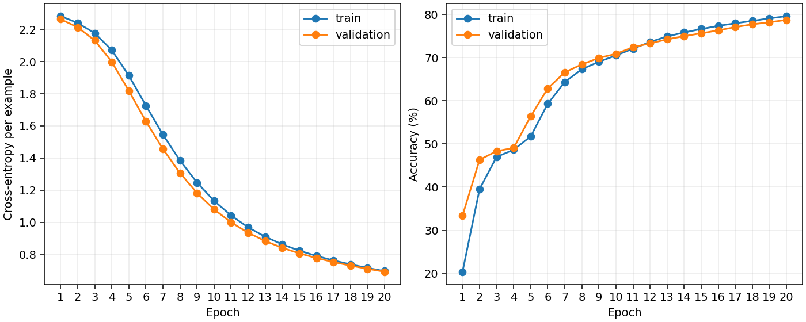

# KMNIST MLP learning exercise

A PyTorch multilayer perceptron for classifying 28 x 28 Kuzushiji-MNIST images.
This exercise demonstrates dataset loading, autograd, optimisation, validation
and held-out evaluation, using Mamadou's existing model and training loop.
See [PROVENANCE.md](PROVENANCE.md) for the source identity and AI-assisted edits.

## Method and provenance

The architecture is flatten -> Linear(784, 512) -> ReLU -> Linear(512, 512)
-> ReLU -> Linear(512, 10). Images are converted to floating-point tensors in
[0, 1]. Cross-entropy and SGD with learning rate 0.001 are preserved.

Codex extracted the architecture from the supplied `kminst_mlp.py`, corrected
its naming and moved execution into the trainer. The architecture,
seeded weights and forward outputs were compared against the original class
and match exactly. The original file was left unchanged.

The original uses 60,000 training images and evaluates the test set after every
epoch. This prepared workflow instead holds out 5,000 training examples for
validation (55,000/5,000 split, seed 42), selects the lowest-validation-loss
checkpoint, and evaluates the separate 10,000-image test set once at the end.
Results therefore are not directly comparable with a run of the original file.

Codex adapted the original training loop into `train.py`, adding
example-weighted metrics, seeded initialisation/shuffling, checkpoint saving,
plotting, CLI options and tests. Earlier tutorial sources and independent
authorship have not been verified; Mamadou should confirm them.

## Reproduce

From the **repository root** with Python 3.10+:

```powershell
python -m pip install -r requirements.txt
python train.py --epochs 20 --seed 42
```

CUDA is selected when available; `--device cpu` forces CPU. Data downloads to
`./data`; use `--data-root PATH --no-download` for an existing cache. Outputs
are `outputs/kmnist-seed42/{metrics.json,curves.png,best.pt,last.pt}`. Use a new
`--output-dir PATH` for another run; nonempty directories are rejected.
Checkpoints include model and optimiser state, epoch and seed. Resume is not
automated. Data and weights are excluded from Git.

Run dataset-free training tests with:

```powershell
python -B -m unittest discover -s tests -v
```

Dataset information and attribution: https://github.com/rois-codh/kmnist

## Results and limitations

The measured 20-epoch, seed-42 baseline selected epoch 20 by validation loss:

| Metric | Measured result |
|---|---:|
| Validation accuracy at selected epoch | 78.72% |
| Held-out test accuracy (10,000 images) | 65.34% |
| Held-out test cross-entropy | 1.1184 |
| Trainable parameters | 669,706 |

Full history and conditions: [metrics.json](results/metrics.json).



The validation/test gap is visible evidence requiring interpretation; these
figures do not demonstrate generalisation beyond this dataset. Preparation
used Python 3.12, torch 2.14.0+cu126, torchvision 0.29.0+cu126 and an RTX 4080
SUPER. Elapsed time in the JSON is a run observation, not a hardware benchmark.
The baseline uses one seed and the original script's 20-epoch budget. It is
not a tuned or converged benchmark. Deterministic
settings do not guarantee identical outcomes on other hardware or versions.
The dependency list is not a lock file. Earlier tutorial attribution remains
to be confirmed. Code is licensed under [MIT](LICENSE); see [third-party notices](THIRD_PARTY_NOTICES.md).


## Repository history

Extracted from the existing portfolio at commit
[`6ad431f`](https://github.com/mamadoufoune6-spec/Data-sciencePortfolio/commit/6ad431ff7eb69089dddb615245673d22a7ebe351).
The measured baseline is retained unchanged. This is a standalone extraction,
not a newly trained experiment. See [PROVENANCE.md](PROVENANCE.md).
